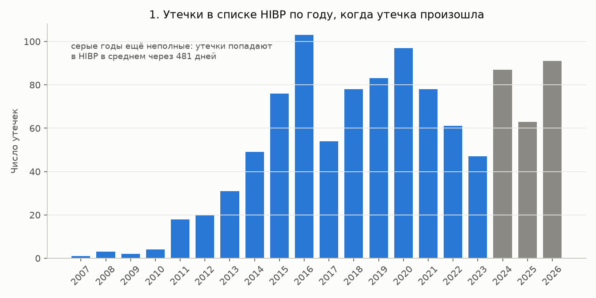
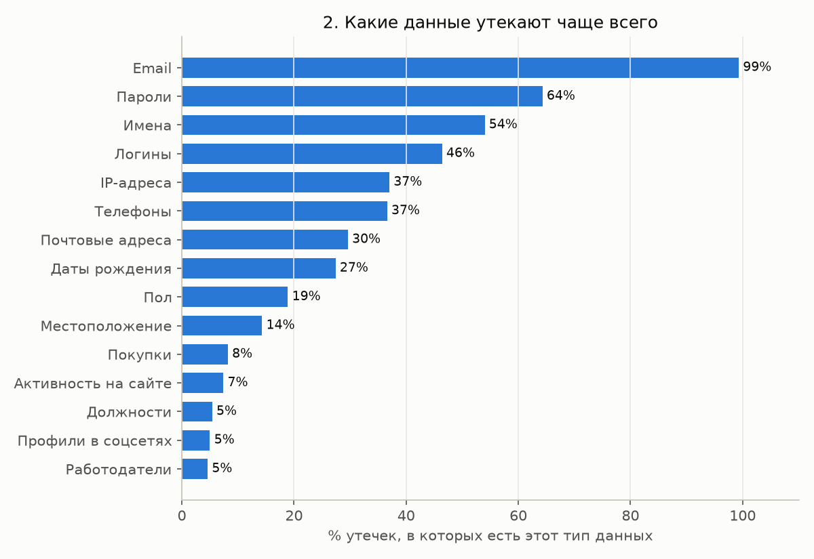
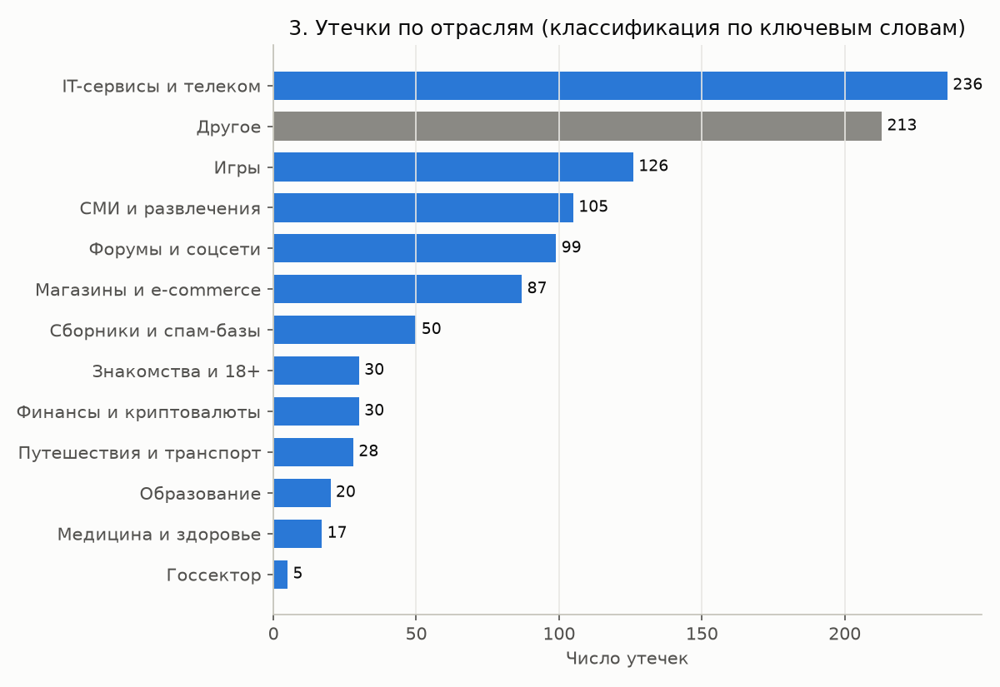
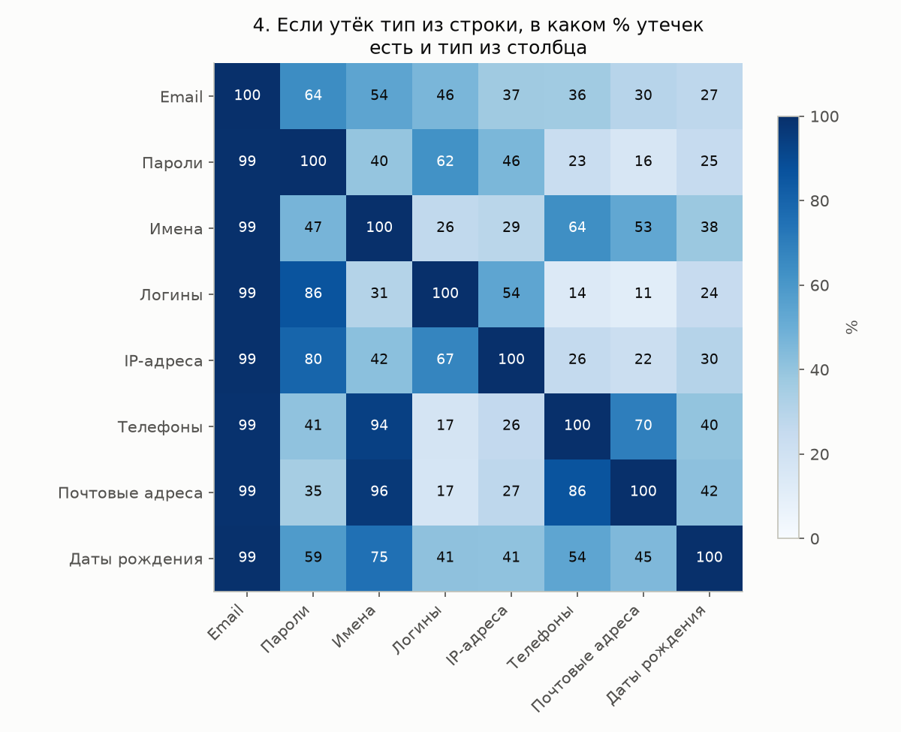
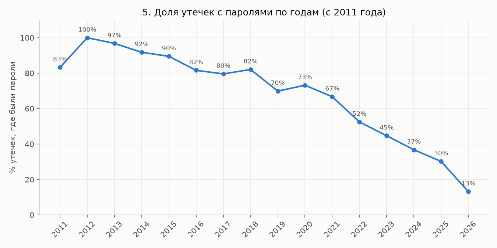

# Утечки данных: что и у кого утекает

Все мы часто в сети слышим отдельные громкие утечки информации и не только. Мне захотелось посмотреть на них сверху и проанализировать: что утекает чаще всего, у кого и меняется ли это со временем. А ещё понять, какие советы про пароли подтверждаются цифрами, а какие просто принято повторять.

Я разобрала публичный список из 1 046 известных утечек с сайта [Have I Been Pwned](https://haveibeenpwned.com) и ответила на три вопроса: в каких отраслях утечек больше, какие данные утекают и как это менялось по годам. Основной анализ я сделала SQL-запросами к базе SQLite, графики нарисовала на Python.

## Данные

- **Источник.** Have I Been Pwned (HIBP), сервис, где можно проверить, есть ли ваш email в известных утечках. Список утечек лежит по открытому адресу `https://haveibeenpwned.com/api/v3/breaches`, ключ и регистрация не нужны.
- **Дата.** Я скачала список 4 ноября 2026 года. Снимок лежит в [data/raw/breaches.json](data/raw/breaches.json), поэтому результаты воспроизводятся.
- **Лицензия.** [CC BY 4.0](https://creativecommons.org/licenses/by/4.0/): данные можно использовать с указанием источника. Источник: Have I Been Pwned (haveibeenpwned.com).
- **Содержимое.** По каждой утечке есть название сервиса, домен, дата утечки, дата добавления в HIBP, число затронутых аккаунтов, типы утёкших данных и описание. Данных о конкретных людях в списке нет.
- **Период.** Утечки произошли с 12 июля 2007 по 4 октября 2026 года.

**Почему Have I Been Pwned.** Для вопроса «какие данные утекают» нужен список типов данных у каждой утечки. В HIBP он есть в готовом виде: 164 типа, от email до паспортов. Например, в списке утечек в Википедии такой колонки нет. Ещё у HIBP открытый API без ключа и понятная лицензия, а сам сервис ведёт исследователь безопасности Трой Хант и помечает, проверена ли утечка (в моём снимке проверены 1 007 из 1 049). Минус в том, что HIBP собирает только утечки с email-адресами, об этом ниже в «Ограничениях».

## Что я сделала

1. Разобрала формат ([scripts/02_prepare.py](scripts/02_prepare.py), журнал в [results/01_preparation_log.txt](results/01_preparation_log.txt)). Каждая утечка хранится как запись JSON, а типы данных лежат в ней списком, например `["Email addresses", "Passwords"]`. Я развернула список: одна строка со списком стала несколькими строками, по одной на тип. Получилось 5 570 пар «утечка + тип данных» и 164 разных типа.
2. Почистила данные:
   - убрала 3 утечки, которые HIBP пометил как поддельные, и осталось 1 046;
   - перевела даты из текста в формат дат;
   - проверила пропуски: у 54 утечек нет домена (в основном сборники), даты и число аккаунтов есть у всех;
   - убрала из описаний HTML-теги.
3. Придумала правило для отраслей, потому что в HIBP такого поля нет:
   - почти каждое описание начинается одинаково: «In 2019, the Russian Minecraft service VimeWorld suffered a data breach». Я беру название утечки и начало первого предложения до глагола (suffered, was, had и т.д.), где описан сам сервис;
   - в этом тексте ищу ключевые слова для 12 отраслей, например «game» и «minecraft» для игр или «shop» и «retail» для магазинов. Правила проверяются сверху вниз и срабатывает первое совпадение, поэтому узкие отрасли стоят выше широких. Полный список слов в коде;
   - утечки, которые HIBP пометил как спам-базы, логи стилеров или вредоносные программы, а также комбо-листы и базы брокеров данных я отнесла в группу «Сборники и спам-базы». В них собраны данные из многих источников, а не из одного взломанного сервиса;
   - описания 30 крупнейших утечек я прочитала сама. У 14 из них в описании не сказано, чем занимается сервис («In May 2016, LinkedIn had 164 million email addresses...»), и отрасль я поставила вручную;
   - всё, что не подошло ни под одно правило, попало в «Другое».

   Чтобы проверить правило ([scripts/03_check_industry.py](scripts/03_check_industry.py), [results/02_industry_check.txt](results/02_industry_check.txt)), я взяла 50 случайных утечек, прочитала описания и сама записала отрасль ([data/industry_manual_check.csv](data/industry_manual_check.csv)). Правило совпало с моей разметкой в 35 случаях из 50 (70%). Когда правило выбирало конкретную отрасль, а не «Другое», оно было право в 31 случае из 40 (78%). Больше всего ошибок в «IT-сервисах»: туда попадают сервисы, в описании которых есть «app», «website» или «service».
4. Загрузила данные в SQLite. В базе три таблицы: `breaches` (утечки), `data_classes` (справочник типов данных) и `breach_data_classes` (какие типы были в какой утечке). Это связь «многие ко многим»: в одной утечке много типов, и каждый тип встречается во многих утечках.
5. Написала 10 SQL-запросов ([sql/queries.sql](sql/queries.sql)). Каждый подписан по-русски, результаты лежат в `results/sql_*.csv`. В запросах есть JOIN, GROUP BY, CTE (`WITH ...`), оконные функции (`ROW_NUMBER() OVER`, `SUM() OVER`) и self-join, которым я искала пары типов данных.
6. Построила 5 графиков ([scripts/05_plots.py](scripts/05_plots.py)).

## Выводы

Числа взяты из файлов в [results/](results/).

1. Email есть в 99,3% утечек, пароли в 64,3% (673 из 1 046). За ними идут имена (54,0%), логины (46,4%), IP-адреса (37,0%) и телефоны (36,6%). Чаще всего вместе утекают email и пароль: в 669 утечках. Где утекли логины, в 86% случаев утекли и пароли. Где утекли телефоны, в 94% случаев есть и имена ([график 4](#графики)).
2. Больше всего утечек у IT-сервисов (236), игр (126), СМИ и развлечений (105), форумов и соцсетей (99) и магазинов (87). При этом 213 утечек попали в «Другое», а правило точно примерно на 70–78%, так что порядку соседних отраслей доверять нельзя. Надёжно видно одно: игр, форумов и онлайн-сервисов в списке гораздо больше, чем медицины (17) или госсектора (5).
3. Почти половина затронутых аккаунтов приходится на сборники: 50 записей дают 8,16 млрд из 17,77 млрд (45,9%). Крупнейшая запись, Synthient Credential Stuffing Threat Data (2025), содержит 1,96 млрд аккаунтов. Из десяти крупнейших утечек восемь сборники, и только две относятся к конкретным сервисам: Verifications.io и Facebook.
4. Доля утечек с паролями снижается: 90% в 2015 году, 70% в 2019, 37% в 2024 и 30% в 2025. В 2026 году она 13%, но 51 из 91 утечки этого года связана с группой вымогателей ShinyHunters. Они крадут клиентские базы компаний, и пароли есть только в 2% их утечек. Без них доля 2026 года 27,5%, близко к 2025-му. Причину общего снижения данные не показывают: сервисы могли лучше защищать пароли, а мог измениться состав утечек, которые попадают в HIBP.
5. Больше всего утечек в списке произошло в 2016 году (103). Утечка попадает в HIBP в среднем через 481 день, а 34,6% утечек добавлены больше чем через год. Поэтому 2024–2026 годы ещё неполные, и сравнивать их с прошлыми годами нельзя.

## Что это значит для обычного человека

- Проверьте свой email на [haveibeenpwned.com](https://haveibeenpwned.com). Email есть в 99% утечек из списка, так что если ваш адрес был на взломанном сайте, он почти наверняка утёк.
- Заведите разные пароли для разных сайтов. Пароли есть в двух утечках из трёх и почти всегда вместе с email. Крупнейшие записи в списке представляют собой комбо-листы пар «email + пароль», с которыми злоумышленники автоматически пробуют войти на другие сайты (credential stuffing). С одинаковым паролем утечка одного форума даёт доступ и к другим вашим аккаунтам. Менеджер паролей решает эту проблему.
- Включите двухфакторную аутентификацию (вход с кодом из приложения или СМС). Тогда одного утёкшего пароля для входа не хватит.
- Берегите данные, которые нельзя поменять: документы (они есть в 30 утечках), дату рождения (27% утечек) и адрес (30%). Пароль меняется за минуту, паспорт нет, а по паспортным данным могут оформить кредит.
- Имя, телефон и адрес часто утекают вместе: где утёк адрес, в 96% утечек есть и имя, в 86% телефон. Мошенник с такими данными может позвонить и назвать вас по имени и адресу. То, что звонящий много о вас знает, не повод ему доверять.

## Ограничения

- В списке только утечки, о которых стало известно и которые добавили в HIBP. Часть утечек не раскрывают, поэтому список не годится для выводов вроде «в отрасли X утечек больше всего».
- HIBP ищет по email, поэтому почти все утечки в нём содержат адреса. Утечки без email могли сюда не попасть, и это может быть одной из причин, почему медицины и госсектора в списке мало.
- Отрасли размечены по ключевым словам с точностью около 70–78%, и 20% утечек остались в «Другом». Проверочная выборка маленькая (50 утечек), и размечала её я одна.
- Число аккаунтов не равно числу людей. Один человек может быть во многих утечках, а в сборниках адреса повторяются, поэтому сумма 17,77 млрд больше населения Земли.
- Последние годы неполные: утечки добавляют в HIBP в среднем через 481 день.
- Тип «Passwords» в HIBP объединяет пароли открытым текстом и захешированные пароли, в данных эти случаи не разделены.

## Как запустить

Нужен Python 3.10 или новее, SQLite в него уже встроен.

```bash
python3 -m venv .venv && source .venv/bin/activate
pip install -r requirements.txt
python run_all.py
```

`run_all.py` проверяет снимок данных, собирает базу `data/breaches.db`, сравнивает правило отраслей с ручной разметкой, выполняет SQL-запросы и рисует графики. Запросы можно выполнить и вручную: `sqlite3 data/breaches.db < sql/queries.sql`.

## Графики

**1. Утечки по годам.** Число утечек растёт до 2016 года, потом держится от 47 до 97 в год. Серые годы ещё неполные.



**2. Какие данные утекают чаще всего.**



**3. Утечки по отраслям.** Разметка приблизительная, см. «Ограничения».



**4. Какие данные утекают вместе.** Пример: на пересечении строки «Логины» и столбца «Пароли» стоит 86. Значит, в 86% утечек с логинами были и пароли.



**5. Доля утечек с паролями по годам.**



## Структура проекта

```
README.md
requirements.txt
run_all.py                      запуск всех шагов
data/raw/breaches.json          снимок списка HIBP
data/industry_manual_check.csv  моя ручная разметка 50 утечек
sql/queries.sql                 10 SQL-запросов с подписями
scripts/01_download_data.py     скачивание (только с флагом --refresh)
scripts/02_prepare.py           очистка, отрасли, разворот типов, база SQLite
scripts/03_check_industry.py    сравнение правила с ручной разметкой
scripts/04_run_sql.py           выполнение запросов, ответы в results/sql_*.csv
scripts/05_plots.py             графики
results/                        журналы и результаты запросов
figures/                        графики
```

## Словарик

- **Утечка данных.** Данные пользователей попадают к посторонним: после взлома, из-за ошибки в настройках или по вине сотрудника.
- **Have I Been Pwned (HIBP).** Сайт, который собирает известные утечки и проверяет, есть ли в них ваш email.
- **JSON.** Текстовый формат данных из пар «название: значение». В нём часто отдают данные сайты.
- **Развернуть список (explode).** Превратить строку со списком из N значений в N строк по одному значению.
- **SQLite.** База данных в одном файле, отдельный сервер ей не нужен.
- **SQL.** Язык запросов к базам данных.
- **JOIN.** Соединение двух таблиц по общему столбцу, например по номеру утечки.
- **Self-join.** Соединение таблицы с самой собой. Я так искала пары типов данных внутри одной утечки.
- **GROUP BY.** Группировка строк с одинаковым значением (например, годом), чтобы посчитать что-то по каждой группе.
- **CTE (WITH ...).** Именованный подзапрос: сначала считаем промежуточную таблицу, называем её и используем дальше.
- **Оконная функция.** Считает значение для каждой строки с учётом соседних и не схлопывает строки. Например, номер утечки по размеру внутри года или накопительную сумму.
- **Связь «многие ко многим».** Одной записи соответствует много записей другой таблицы и наоборот. Хранится через отдельную связующую таблицу.
- **Credential stuffing.** Атака: украденные пары «email + пароль» автоматически пробуют на других сайтах.
- **Комбо-лист.** Файл с парами «логин + пароль», собранный из многих утечек.
- **Логи стилеров.** Данные, которые вирусы-«стилеры» крадут с заражённых компьютеров: сохранённые пароли, cookie.
- **Двухфакторная аутентификация.** Вход, для которого кроме пароля нужен код из приложения или СМС.
- **Хеширование пароля.** Превращение пароля в «отпечаток», по которому исходный пароль трудно восстановить.
